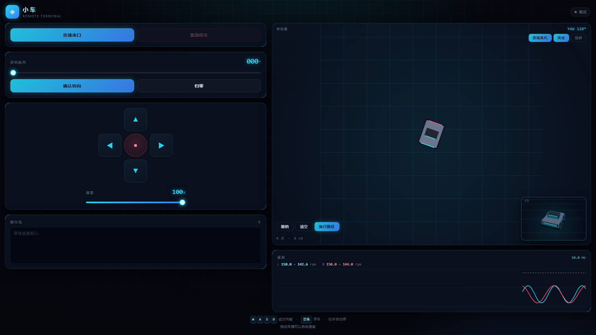

# 网页遥控

浏览器直接控制小车，不经过任何中间程序（不用 Python 脚本）。



## 原理

```
Chrome/Edge  ──Web Serial──>  COM14（蓝牙虚拟串口）  ──蓝牙──>  小车
```

Chrome 的 `navigator.serial` 可以直接打开串口，和串口助手是同一层。

## 打开方式

**方式一：双击 `启动.bat`**

会启动本地服务器并自动打开浏览器。关掉黑窗口即停止。

> 推荐用这个。`file://` 协议下 Chrome 可能不授予串口权限。

**方式二：直接双击 `control.html`**

如果「连接串口」按钮报错说需要安全上下文，改用方式一。

## 用法

| 操作 | 动作 |
|---|---|
| `W` / `↑` | 前进 |
| `S` / `↓` | 后退 |
| `A` / `←` | 原地左转 |
| `D` / `→` | 原地右转 |
| `空格` | 停车 |
| 鼠标点方向键 | 同上 |

**松开按键自动停车**，切走窗口也会停车。

右上角滑杆调速度，20%~100%。低于 100% 时命令会带数字（如 `F60`）。

### 俯视车模

页面顶部是**俯视正交视图**：黑色小车停在固定网格上，转向时车会在网格上转。

- 拖动车模可以自由旋转
- 车模转动时，下面的「目标航向」拉条会同步

### 目标航向

拖动拉条设定 0~359°，点「确认转向」发送：

```
Y<角度>\n      例如 Y90
```

### 地图画线

切到「**画线**」模式，在俯视图上按住拖动画一条路线，点「**执行路径**」：

- 网页上的小车会**沿路径行驶**（页面预览）
- 同时把路径下发给车：

```
P<x0>,<y0>;<x1>,<y1>;...\n     单位 cm，车体坐标系
```

地址栏加 `#demo` 可以直接看一段示例路径。

> ⚠️ 车端还看不懂 `P` 指令，需要先实现里程计 + 位姿估计 + 航点跟踪。

> ⚠️ 车端 `cmd.c` 目前还没有 `Y` 分支，这条命令会被忽略。
> 需要先实现航向外环（陀螺仪 yaw → 差速闭环）。

## 需要什么

- **Chrome 或 Edge**（Firefox / Safari 不支持 Web Serial）
- 小车已烧录支持 `F/B/L/R/S` 命令的固件
- 蓝牙已配对（`JDY-31-SPP`，配对码 1234）

## 手机为什么不行

- Android Chrome **没有** Web Serial
- Web Bluetooth 只支持 **BLE**，而 JDY-31 是经典蓝牙 SPP

手机要用的话，得换 BLE 模块（ESP32 / HM-10），或者用电脑做桥接。

## 命令格式

页面发送的是文本行，以 `\n` 结尾：

```
F\n        前进（满速）
F60\n      前进 60%
B\n        后退
L\n        原地左转
R\n        原地右转
S\n        停
```

对应车端 `cmd.c` 的解析规则。
